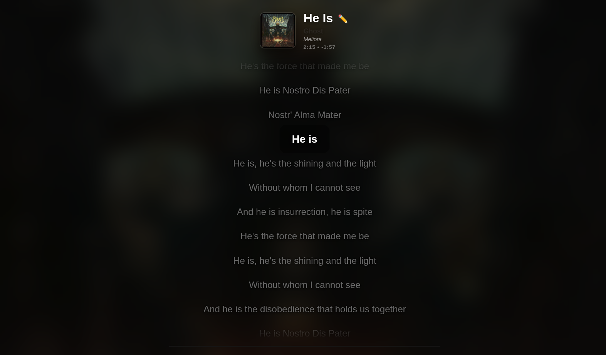
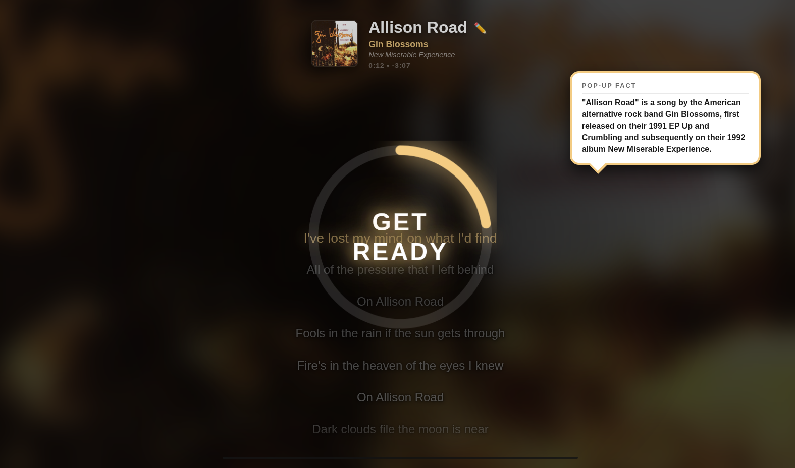

# LyricDeck

**Your music, on the big screen, with the lights down.**

LyricDeck turns any TV, projector, or spare monitor into a stunning synced-lyrics display for your Plex, Jellyfin, or Spotify library: karaoke-style word-by-word highlighting, **real MilkDrop visualizers pulsing live to your room's audio**, pop-up song trivia, and a party mode your guests run from their phones.

**Live demo:** https://plexlyrics.tailf8ec44.ts.net/

## Screenshots


*Karaoke-style highlighting keeps the current line front and center.*


*Pop-up trivia drops song facts during the music.*

## Why LyricDeck

Most lyrics displays are an afterthought — a static panel in the corner of an app. LyricDeck is the *show*. Point it at your music library and you get a full-screen experience built for listening rooms, parties, and streams: every line lands on the beat, the visuals breathe with the music, and when friends come over, they grab the queue from their own phones.

It started as a Plex-first project and grew into a three-source jukebox with the kind of polish usually reserved for commercial karaoke rigs — minus the subscription, the ads, and the hardware dongle.

## Features

- **Real MilkDrop visualizers, live.** Flip on *Live* mode and genuine MilkDrop presets (via Butterchurn) react in real time to your microphone — your room becomes the visualizer input. No audio file access needed. Note: browsers only allow mic access on secure connections, so *Live* mode needs HTTPS (or localhost) to work.
- **Five built-in animated shader styles** (Geiss, MilkDrop, Nebula, Rings, Void) with album-art color theming when you just want motion behind the lyrics.
- **Karaoke party mode** (`/party`): a big-screen display with a huge current line and upcoming-line preview, a shared song queue guests can join with a session code, and **duet parts** you can assign per singer.
- **Phone remote** (`/remote`): guests search the library and queue songs without touching your setup.
- **OBS overlay** (`/overlay`): transparent now-playing + lyrics overlay for streamers.
- **Three playback sources**: Plex (primary), Jellyfin, and Spotify.
- **Synced lyrics** from LRCLib with manual search and per-song overrides when the wrong lyrics load.
- **Romaji toggle** for Japanese lyrics (kuroshiro), **pop-up trivia** from Genius annotations, gapless prefetch of upcoming tracks, and persistent lyric corrections that survive restarts.
- **Help page** (`/help`) so guests can onboard themselves.

## Quick start

```bash
npm install
cp .env.example .env   # then fill in what you use
node server.js
```

Open http://localhost:3000 and pick your playback provider. Point a TV browser at `/party` for the big-screen experience.

## Configuration

| Variable               | Required | What it does                                                        |
|------------------------|----------|---------------------------------------------------------------------|
| `PORT`                 | No       | Port to listen on (default 3000)                                    |
| `SPOTIFY_CLIENT_ID`    | For Spotify | Spotify app client ID                                            |
| `SPOTIFY_CLIENT_SECRET`| For Spotify | Spotify app client secret                                        |
| `GENIUS_ACCESS_TOKEN`  | No       | Genius API token for song annotations (get one at genius.com/api-clients) |
| `JELLYFIN_URL`         | For Jellyfin | Base URL of your Jellyfin server, e.g. http://192.168.1.10:8096 |
| `JELLYFIN_API_KEY`     | For Jellyfin | Jellyfin API key (Dashboard > API Keys)                          |

Plex uses per-user PIN login — no env vars needed. Jellyfin auth is server-side, so "Continue with Jellyfin" just works once the env vars are set.

User data (lyric overrides, sync offsets, party queue) is stored in `data/persist.json`.

## Routes

| Route      | What it is                                                        |
|------------|-------------------------------------------------------------------|
| `/`        | Main lyrics display                                               |
| `/party`   | Karaoke party mode (big screen)                                   |
| `/remote`  | Phone remote for guests                                           |
| `/overlay` | Transparent OBS overlay                                           |
| `/help`    | Guest help page                                                   |

## Acknowledgments

LyricDeck stands on open source:

- [Butterchurn](https://github.com/jasonsantelli/butterchurn) (MIT) — the real MilkDrop visualizer engine for the web, by Jordan Santell
- [butterchurn-presets](https://github.com/jasonsantelli/butterchurn-presets) (MIT) — the MilkDrop preset collection
- [Express](https://expressjs.com/) (MIT) — web server
- [Axios](https://axios-http.com/) (MIT) — HTTP client
- [dotenv](https://github.com/motdotla/dotenv) (BSD-2-Clause) — environment config
- [Kuroshiro](https://github.com/hexenq/kuroshiro) (MIT) and [kuroshiro-analyzer-kuromoji](https://github.com/hexenq/kuroshiro-analyzer-kuromoji) (MIT) — Japanese romaji conversion
- [LRCLib](https://lrclib.net/) — synced lyrics API
- [Genius](https://genius.com/) — song annotations API

The five built-in shader styles are original GLSL written for LyricDeck; the *Live* visualizer mode runs genuine MilkDrop presets through Butterchurn.

## Donate

LyricDeck is free and open source. If it makes your listening better, you can support its development here:

- [Donate with PayPal](https://www.paypal.com/donate?hosted_button_id=LS8RG7GS6GWGU)

## License

MIT. See [LICENSE](LICENSE).
